# Faithful Lecture Notes

Turn a lecture transcript (plus optional slides) into proportionate, source-faithful study notes — engineered to keep the LLM honest.

One **Architect** LLM call reads the full sources and plans the notes as structured section work orders. Parallel **Assembler** calls each write exactly one section: full sources, but only their own assignment. Deterministic code stitches the sections in plan order and audits the result.

**No LLM call ever reads or rewrites the whole generated document.** The merge is mechanical. The audit is code. Every node checkpoints to disk, so an interrupted run resumes exactly where it stopped.

## Design philosophy

Three convictions shape everything in this pipeline:

1. **Decompose a sophisticated task into small, easy ones.** "Read a two-hour lecture and produce faithful, well-proportioned notes" is a hard single task: long input, competing emphases, many judgement calls. LLMs fail these jobs in predictable ways — drift, omission, invented content — and the risk grows with how much one call is asked to hold and produce. So the pipeline never asks any call to do the whole job. One model call only *plans* the notes (the Architect); each writing call produces *one bounded section* (an Assembler); and everything that does not require understanding — routing, validation, stitching, auditing — is done by deterministic code, which does not hallucinate at all.

2. **Every node gets an independent, narrow context.** Each LLM call receives exactly the context its task needs and nothing more. Assemblers see the full sources but only their own work order, so they structurally cannot duplicate a neighbouring section's material. No call ever sees the stitched document, so no call can "improve" it into a fluent rewrite with invented content. Narrow contexts also mean smaller prompts, lower cost per call, and outputs that are easy to check mechanically.

3. **A pipeline, not a skill.** A single do-everything prompt is fragile: it is hard to test, hard to version, and one edit changes every behaviour at once. This project takes the opposite approach — each node has its own small, fixed system prompt with a single responsibility and a machine-checkable output contract. Prompts here are *managed artefacts*, not incantations: every run stores the exact prompts it used under `prompts/` and hashes them into the run manifest, so a prompt edit is always visible and traceable, and the contract checks plus the structural audit catch a bad edit before it reaches your notes.

The compounding effect is what makes the result trustworthy: hallucination risk concentrates in long, open-ended generation and in full-document rewriting, and this design removes both by construction. Each individual task is small enough to verify with a hard contract (valid JSON for the plan, an exact section heading for each section), so a failed call is caught and retried rather than silently degrading the notes.

## Architecture

```mermaid
flowchart LR
    A["Input<br/>transcript + optional slides<br/>(md / txt / pdf / pptx / docx)"] --> B["Format conversion<br/>convert.py — pure code"]
    B --> C["Architect<br/>one LLM call → Assembly Plan (JSON)"]
    C --> D["Plan validation & normalisation<br/>plan.py — pure code"]
    D --> E["Assembler × N<br/>parallel LLM calls, one section each"]
    E --> F["Mechanical stitch<br/>pure code, plan order"]
    F --> G["Structural audit<br/>plan.py — pure code"]
    G --> H["04_final/lecture_summary.md"]
```



The pipeline runs as a linear LangGraph of seven nodes:
`load_inputs → architect → prepare_assembler_jobs → assemble_sections → stitch_sections → audit → save_summary`.

Key mechanisms:

- **The Assembly Plan is the routing table.** Each section work order carries a `section_id`, `section_title`, `purpose`, a restrained list of `central_concepts`, an optional `boundary_note` preventing overlap with neighbouring sections, and optional `necessary_cross_references`. The plan is validated by code (duplicate IDs rejected and renumbered, cross-reference targets must exist, the final section must be `Administrative Notes and Preview`); an invalid plan is sent back to the Architect with the validation error.
- **Assembler isolation.** Every Assembler receives the complete transcript and slides, a short global outline mechanically derived from all sections' IDs/titles/purposes, and only its own work order — so it cannot see what other sections own, which prevents duplication at the mechanism level.
- **Contract-checked retries.** Every LLM call has a hard output contract (valid JSON for the Architect; exact `## N. Title` heading for Assemblers) checked by code, with automatic retries (default 10 attempts per node).
- **Checkpointed resume.** Every node's output is written to disk. `--resume` continues an interrupted run, but only if the run fingerprint — hashes of the inputs, configuration, prompts, and implementation — matches the stored manifest exactly. A changed input or model means a new output directory, not a mixed run.

### LLM vs code responsibilities

| LLM (narrow context) | Code (deterministic) |
|---|---|
| Architect: understand the lecture, produce the plan | Format conversion (pdf/pptx/docx → Markdown) |
| Assemblers: write one assigned section each | Plan validation, ID normalisation, outline/work-order rendering |
| | Output contract checks and retries |
| | Stitching sections in plan order (no rewriting) |
| | Structural audit: section count, verbatim H2 headings, cross-reference discipline, preview placement, path-leak markers |

### LLM roles and defaults

| Role | Calls | Input | Output | Defaults |
|---|---|---|---|---|
| Architect | 1 | Full transcript + slides | Assembly Plan (JSON), 6–9 sections for a typical 2-hour lecture | `deepseek-v4-pro`, temperature 0.5, thinking on, `reasoning_effort=max` |
| Assembler | 1 per section, parallel | Full sources + global outline + own work order | One Markdown section | Same model, temperature 0.2, thinking on |

## Make the prompts your own

The structure is the product; the prompts are meant to be redesigned. The bundled prompts are tuned for university lectures — they occasionally mention cases and statutes because the pipeline was built on law lectures — but they are plain strings in `lecture_summary_pipeline/prompts.py`, and you are encouraged to rewrite them for your own discipline, note style, or language while keeping the pipeline structure intact.

The scaffolding makes such edits safe and manageable:

- **Keep the contract lines untouched.** The Architect prompt's "return exactly one valid JSON object" instruction and the Assembler prompt's "start directly with `## [section_id]. [section_title]`" rule are what `plan.py` and the retry logic verify. Change the substance freely; leave these output-contract sentences in place.
- **Every edit is traceable.** A run records the exact prompts it used in `prompts/` and hashes them into `00_run_manifest.json`. Because the fingerprint covers the prompts, a prompt change means a new output directory rather than a silently mixed run — you always know which notes were produced by which prompt version.
- **Failures surface loudly.** If a redesigned prompt breaks the output contract, the node retries and then fails with a clear error instead of emitting degraded notes; the final structural audit (`05_audit.json`) is unaffected by prompt content and still validates the result.
- **Test cheaply.** Iterate against the bundled `examples/` mini-lecture, and run the mocked test suite (`pytest tests -q`) to confirm the mechanics still hold — neither costs API credit beyond your own smoke runs.

If you build a variant that works well for a different field, that is the intended use of this repository: same engine, your prompts.

## Why an LLM API is required

This repository contains no model weights and no "AI magic" of its own — it is a workflow engine. Everything that can be deterministic is plain code (conversion, validation, stitching, auditing); the LLM is invoked only where genuine reading and writing is required: one Architect call to plan the lecture, and one Assembler call per section to write it.

The API calls exist to make an LLM **follow the preset process reliably**, not to chat with it ad hoc. Each call is dispatched with a fixed system prompt, a narrow task, and a hard output contract that code verifies before accepting the result (valid JSON matching the plan schema for the Architect; the exact `## N. Title` heading for each Assembler). Calls that fail the contract are retried automatically. That is what "stable" means here: the same inputs run through the same fixed pipeline and produce structurally verified notes, regardless of which compliant endpoint you point it at.

Cost is therefore predictable: one run is one Architect call plus one Assembler call per planned section (typically 7–10 calls for a two-hour lecture). Every node checkpoints to disk, so an interrupted run resumes without re-paying for completed sections.

## Setup guide (for humans and AI agents)

An AI agent can execute this checklist autonomously; each step is verifiable before moving on.

1. **Clone the repository**

   ```bash
   git clone <repo-url> lecture-summary-pipeline
   cd lecture-summary-pipeline
   ```

2. **Create a virtual environment** (Python 3.11 or later required; check with `python3 --version`)

   ```bash
   python3 -m venv .venv
   source .venv/bin/activate   # Windows: .venv\Scripts\activate
   ```

3. **Install dependencies**

   ```bash
   pip install -r requirements.txt
   # or, to install as a package with the `lecture-summary` console script:
   pip install .
   ```

4. **Configure the API.** Get an API key from your chosen provider, then set the environment (or pass `--api-key` / `--base-url` on the command line). Resolution order: CLI argument → `LLM_API_KEY` / `LLM_BASE_URL` → `DEEPSEEK_API_KEY` / `DEEPSEEK_BASE_URL` → `OPENAI_API_KEY` (key only) → default endpoint `https://api.deepseek.com`.

   ```bash
   export LLM_API_KEY="your-key"
   # only if you are not using the DeepSeek default endpoint:
   export LLM_BASE_URL="https://your-endpoint.example/v1"
   ```

   Three common configuration styles:

   | Style | What to set | Notes |
   |---|---|---|
   | DeepSeek official API (default) | `LLM_API_KEY` (or `DEEPSEEK_API_KEY`) | Nothing else needed; base URL defaults to `https://api.deepseek.com`, models default to `deepseek-v4-pro`. The DeepSeek-specific thinking-mode parameters (`thinking.type=enabled`, `reasoning_effort`) are sent only to this endpoint. |
   | Any OpenAI-compatible cloud endpoint | `LLM_API_KEY`, `LLM_BASE_URL=https://.../v1`, and `--architect-model` / `--assembler-model` matching that provider's model names | Thinking mode is requested via a generic `enable_thinking` body parameter; use `--disable-architect-thinking` / `--disable-assembler-thinking` if the provider rejects it. |
   | Fully local models (Ollama, LM Studio, vLLM) | `LLM_BASE_URL=http://localhost:<port>/v1` (e.g. `http://localhost:11434/v1` for Ollama), any placeholder `LLM_API_KEY`, and local model names via `--architect-model` / `--assembler-model` | No data leaves your machine. Lower `--parallelism` to match your hardware, and disable thinking if the local server does not support it. |

   **Model capability requirement:** the Architect must return structured JSON, so the chosen model must support JSON-object output reasonably well. The pipeline also passes `response_format={"type": "json_object"}`; endpoints that ignore it still usually work because the client extracts the first valid JSON object from the reply, but a model that cannot follow a JSON schema at all will fail the Architect step.

5. **Smoke-test with the bundled examples** (a fictional 10-minute mini-lecture, no real course material needed)

   ```bash
   python -m lecture_summary_pipeline.cli \
     --transcript examples/transcript.md \
     --slides examples/slides.md \
     --output-dir runs/demo
   ```

   Success looks like: `Audit passed: True` and a readable `runs/demo/04_final/lecture_summary.md`. This costs one Architect call plus one Assembler call per planned section.

6. **Run your real inputs** the same way, pointing `--transcript` (and optionally `--slides`) at your files. See *Inputs: what you need* below before you start.

## Development model note

This pipeline was developed and tested against **DeepSeek V4 Pro** (`deepseek-v4-pro`, the 0813 checkpoint) with thinking enabled and `reasoning_effort=max`, at Architect temperature 0.5 and Assembler temperature 0.2. Those are the defaults, and the prompts were tuned against that model's behaviour. Other models work through the OpenAI-compatible interface, but expect to adjust: weaker models may need lower `--parallelism`, may struggle with the Architect's JSON contract, and may not support thinking mode (`--disable-architect-thinking`, `--disable-assembler-thinking`). Re-tuning temperatures for a different model is normal.

## Inputs: what you need

**The pipeline assumes a transcript already exists.** It accepts `.md` / `.markdown` / `.txt` directly, and auto-converts `.pdf` and `.docx`; slides additionally accept `.pptx`. It deliberately does **not** perform transcription — there is no audio handling in this repository.

If you only have audio or video, transcribe it first. A practical route is to have an AI agent drive an ASR service for you:

- **Recommended (what the author uses):** Aliyun DashScope's Qwen-Audio 3.0 ASR, model `qwen-audio-3.0-asr-flash-filetrans` (file-transcription endpoint). An agent can script it with the `dashscope` Python SDK or through DashScope's OpenAI-compatible endpoint.
- **Local alternative:** Whisper or faster-whisper, if you prefer to keep recordings on your own machine.

Clean the resulting transcript lightly (remove obvious ASR garbage, keep the content verbatim otherwise — the Assembler prompt already tolerates and silently corrects small transcription errors in names and terminology), then run this pipeline.

## Privacy and legal notice

Read this before processing real course material.

- **Copyright.** Lecture recordings, slides, and handouts are usually the intellectual property of the university and/or the lecturer. Transcribing or summarising them does not transfer any rights to you.
- **Privacy.** Recordings and transcripts can capture other students' voices, questions, and personal information. Recording, surveillance, and data-protection laws differ by jurisdiction — for example the *Privacy Act 1988* (Cth) in Australia, the GDPR in the European Union, and various state laws in the United States. Do not record or transcribe without the permissions your institution and jurisdiction require.
- **Generated notes.** Treat both the inputs and the generated notes as **personal study reference only**. Do not publish, share, or upload the recordings, transcripts, slides, or generated notes to public repositories, forums, or third-party services.
- **API processing.** Unless you run fully local models, your transcript and slides are sent to a third-party LLM API. Check that this is acceptable for your material before you run the pipeline.

You are responsible for your own compliance with copyright, privacy, and institutional rules.

## Usage

```bash
python -m lecture_summary_pipeline.cli \
  --transcript /path/to/transcript.docx \
  --slides /path/to/slides.pptx \
  --output-dir runs/week1
# or, after `pip install .`: lecture-summary --transcript ... --output-dir ...
```

- `--slides` is optional (omit it when the lecture has no slides).
- `--resume` continues an interrupted run in the same output directory. Resume is **fingerprint-checked**: the stored manifest hashes the input contents, the pipeline configuration, the prompt set, and the implementation files. If anything changed — different inputs, different models, edited prompts — resume is refused and you must use a new output directory. This prevents mixing artefacts from different runs.
- After a run, check `05_audit.json`; `"passed": true` means the structural audit succeeded. If the audit fails, the CLI exits with **exit code 2** and leaves all artefacts in place for inspection.

Useful optional flags: `--architect-model`, `--assembler-model`, `--parallelism` (default 50), `--disable-architect-thinking`, `--disable-assembler-thinking`, `--architect-temperature`, `--assembler-temperature`, `--node-retry-attempts` (default 10). Full list: `python -m lecture_summary_pipeline.cli --help`.

### Run artefacts

```text
runs/week1/
  00_run_manifest.json        run fingerprint (inputs + config + prompts + code hashes)
  00_workflow.mmd             mermaid diagram of the pipeline graph
  inputs/                     the converted transcript.md / slides.md actually used
  prompts/                    the system prompts actually used
  01_assembly_plan.json       validated, normalised section plan
  01_architect_request.json   Architect call parameters (no source content)
  01_architect_attempts.json  per-attempt status log
  02_global_outline.md        outline mechanically derived from the plan
  02_work_orders/*.json       one work order per section
  03_sections/*.md            the finished section files
  03_sections/*.request.json / *.attempts.json
  04_final/lecture_summary.md the final stitched study notes
  05_audit.json               structural audit report
```

## Input formats

| Format | Behaviour |
|---|---|
| `.md` / `.markdown` / `.txt` | Used directly (must be valid UTF-8) |
| `.pdf` | Text layer extracted automatically. **Text-layer PDFs only** — a scanned PDF without a text layer will raise an error; run it through an OCR tool first |
| `.pptx` | Per-slide text, tables, and SmartArt extracted deterministically |
| `.docx` | Paragraphs, headings, and tables extracted |
| `.ppt` / `.doc` (legacy) | Not supported; re-save as `.pptx` / `.docx` first |

## Testing

```bash
pytest tests -q
```

The suite uses a mocked LLM client — it makes no network calls and spends no API credit. It covers plan validation, the audit, retries, resume/fingerprint behaviour, input routing, format conversion, and the API client's credential resolution.

## Disclaimer

This repository shares an idea and an engineering approach — a pipeline structure and its prompt patterns — not course content. It contains no lecture recordings, transcripts, or slides from any institution; the bundled example lecture is entirely fictional. No copyright infringement is intended.

If you use this pipeline, the responsibility for the materials you process stays with you: check the copyright and licensing status of your lectures before uploading, sharing, or publishing anything derived from them, and obtain permission from the rights holder (usually your university or lecturer) where required.

## License

MIT — see [LICENSE](LICENSE).
